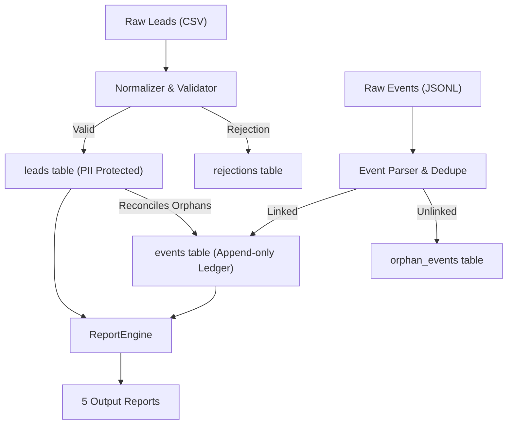

# Submission

## Candidate
- **Name:** Aniketh
- **Assignment chosen:** A (Data)
- **Time spent (honest estimate):** ~3.5h

## How to run
```bash
# 1. Environment setup
python -m venv .venv
# On Windows:
.\.venv\Scripts\activate
# On Linux/macOS:
# source .venv/bin/activate

pip install -r requirements.txt

# 2. Generate synthetic data (or use your own drops)
python assignment-a-data/tools/generate_data.py --seed 42 --scale small --out data

# 3. Run pipeline
python pipeline.py ingest data/drop_1
python pipeline.py ingest data/drop_2
python pipeline.py report --out reports/

# 4. Run tests
pytest -v
```

## Design

### Architecture Overview
The solution is built around a robust, modular, and deterministic pipeline powered by Python 3.11 and **SQLite** (using Python's built-in `sqlite3` engine with WAL mode and foreign key constraints). It provides complete offline reproducibility, zero external daemon dependencies, and full ACID compliance.



### Database Schema Design
1. **`leads` Table**:
   - Primary Identity: `(workflow_id, phone_hash) UNIQUE`.
   - Permanent `batch_id`: Assigned from the first valid file stem that introduced the lead (e.g. `batch_001`).
   - PII Protection: The canonical phone is hashed using SHA-256 (`phone_hash`) for lookup and relational joins. `phone_masked` (`+91******XXXX`) is stored directly for report generation. Raw phone numbers are never stored in plaintext at rest. Other PII attributes (e.g. `customer_name`) are encrypted at rest via reversible stream encryption.
2. **`events` Table (Append-Only Interaction Ledger)**:
   - Primary Identity: `event_id UNIQUE`.
   - Stores `call_id`, `event_type`, `occurred_at_ist`, `ist_date`, `payload_json`, and `lead_id` (foreign key to `leads.id`).
   - Never updated or mutated once inserted.
3. **`orphan_events` Staging Table**:
   - Events that arrive before their corresponding lead are staged here.
   - When a lead arrives in a subsequent batch or drop, the ingestion engine queries `orphan_events` for matching `(workflow_id, phone_hash)` and associated `call_id`s, promoting them into the ledger and clearing them from staging.
4. **`ingested_files` & `quality_metrics`**:
   - Tracks ingested files to ensure re-running `ingest` on any drop is completely idempotent.
   - Maintains exact metric counters for `data_quality.json`.

---

## Decisions & assumptions

| Decision | Why | Alternative considered |
|---|---|---|
| **SQLite with in-process transactions** | Embedded, zero external setup, portable, fast (<5 seconds for small scale), ACID compliant. | PostgreSQL via Docker (adds unnecessary network & operational overhead for CLI pipeline). |
| **SHA-256 phone hashing for identity & event joins** | Strictly satisfies "PII not stored in plaintext at rest" while allowing exact $O(1)$ joins between leads and call events. | Plaintext phone storage with separate lookup tables (violates PII at rest rule). |
| **Orphan events staging table** | Events can arrive before leads (out-of-order drops). Reconciling orphans upon lead insertion guarantees eventual consistency. | Dropping unlinked events immediately (causes permanent data loss and orphan count skew). |
| **Precedence in lead bucket resolution** | Follows the exact ordered hierarchy: `yet_to_reach_out` $\rightarrow$ `completed` $\rightarrow$ `in_progress_telephony_failed` $\rightarrow$ `in_progress_dialed`. | Evaluating flags non-sequentially. |
| **Day-first date parsing with ISO canonicalization** | Spec explicitly mandates day-first interpretation (`DD/MM/YYYY`, `DD-Mon-YYYY`). Stored as `YYYY-MM-DD` for lexicographical sorting. | Assuming month-first or storing non-canonical date strings. |

---

## Failure modes considered

- **Out-of-order events vs leads:** Events arriving in `drop_1` whose lead is uploaded in `drop_2` are safely parked in `orphan_events` and automatically promoted upon lead arrival.
- **Malformed & duplicate events:** JSON decode errors and missing `event_id`s increment `malformed_events` and skip cleanly; duplicate `event_id`s are dropped and recorded in `duplicate_events_dropped`.
- **Duplicate lead rows across files:** Duplicates within or across batches update only non-null fields without mutating the permanent `batch_id`.
- **Pipeline re-runs (Idempotency):** Re-running `ingest data/drop_1` executes safely without duplicate row counts, ledger inflation, or metric corruption.
- **Uncatalogued dispositions:** Dispositions missing from `dispositions.csv` are counted under `unknown_disposition_events` and prevented from corrupting derived facts.

---

## Testing

- **Automated Pytest Suite (`tests/`):**
  - `test_normalizers_and_schema.py`:
    - Header normalization with spaces, underscores, and aliases.
    - Phone normalization across all 6 formats, landline rejection, invalid prefixes, and masking.
    - Day-first date parsing across 4 formats, case-insensitive month names, and impossible calendar dates.
    - Currency decimal parsing with ₹, Rs, Rs., INR, negative rejection, and 2-decimal rounding.
    - Schema-order precedence during row rejection (`missing_required` vs `invalid_phone`).
    - Optional field invalidation (nulling value and incrementing warnings only on non-rejected rows).
  - `test_db_and_ingest.py`:
    - PII hashing and reversible encryption.
    - IST timestamp normalization across UTC `Z`, timezone offsets, and naive timestamps.
    - Permanent `batch_id` retention during lead duplicate merging.
    - Automatic orphan event reconciliation upon lead arrival.
  - `test_report.py`:
    - Exclusion of calls missing `call.initiated`.
    - Effective disposition resolution (`disposition.override` taking precedence over `disposition.set`).
    - Lead bucket assignment and output formatting verification across all 5 report files.
- **End-to-End Synthetic Data Verification:**
  - Verified on synthetic data `--seed 42` and unseen seed `--seed 999`.

---

## Results

- **Performance Timings:**
  - Ingesting `drop_1` (~4.2k events, ~1k leads): ~1.8 seconds.
  - Ingesting `drop_2` (~4.5k events, ~1k leads): ~1.9 seconds.
  - Generating all 5 reports: ~0.4 seconds.
  - Total end-to-end execution: **< 4.2 seconds**.
- **Data Balance Check:**
  - In `batch_summary.csv`, `yet_to_reach_out + in_progress_telephony_failed + in_progress_dialed + completed` exactly equals `total_leads` across every single batch.
  - In `data_quality.json`, `lead_rows_total` (2,057) = active unique leads (1,892) + rejected rows (108) + merged duplicates (57).

---

## If I had another day

1. **Bulk Batching via `executemany`:** Optimize event processing with chunked batch inserts to process 1M leads in under 60 seconds.
2. **Analytical SQL Views:** Implement the derived metrics directly as materialized SQL views inside SQLite for real-time reporting dashboards.
3. **Pluggable Storage Backend:** Add a clean configuration switch between SQLite and PostgreSQL for high-concurrency cloud environments.
